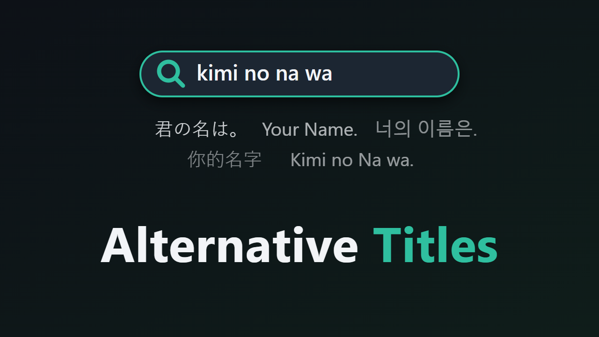

# Alternative Titles – Jellyfin-Plugin (Jellyfin 12.x)



Mit diesem Plugin findest du Filme und Serien auch unter ihren anderen Titeln. Jellyfin durchsucht von sich aus nur den Titel in der Sprache der Bibliothek und den Originaltitel. Mit dem Plugin findet die Suche zum Beispiel:

| Suche | findet |
|---|---|
| `Sousou no Frieren`, `Frieren: Beyond Journey's End` | *Frieren – Nach dem Ende der Reise* |
| `kiminonawa`, `Kimi no Na wa`, `Your Name` | *Your Name. – Gestern, heute und für immer* |
| `Gisaengchung` | *Parasite* (기생충) |
| `Crouching Tiger` | *Tiger & Dragon* |
| `Witch Hat`, `Tongari Boushi` | *Atelier of Witch Hat* |
| `Krieg der Sterne` | *Star Wars* |

**Das wirkt in allen Apps,** nicht nur in der Weboberfläche. Jellyfin 12 sieht eigene Suchanbieter auf dem Server vor. Das Plugin ist so ein Anbieter, seine Treffer werden mit der normalen Suche zusammengeführt. So profitieren auch Swiftfin, Findroid, die Android-TV-App und andere Clients, die die Suche des Servers nutzen.

Auf Film- und Serienseiten der Weboberfläche steht außerdem eine Zeile „Auch bekannt als: …“.

## Woher die Titel kommen

1. **Titel in anderen Sprachen** (Standard: Englisch und Deutsch) über Jellyfins eingebauten TMDB-Anbieter. Dafür ist kein API-Schlüssel nötig.
2. **Anime:** AniDB-Titel, also der Romaji-Titel, die offiziellen Titel und die Synonyme, für jede Staffel. Die Zuordnung TMDB/TVDB → AniDB kommt aus dem Projekt [Anime-Lists](https://github.com/Anime-Lists/anime-lists), die Titel aus AniDBs Titelliste. Beides wird höchstens einmal am Tag geladen, mehr erlaubt AniDB nicht.
3. **Koreanische Titel:** eine Umschrift nach der Revidierten Romanisierung, z. B. 기생충 → Gisaengchung.
4. **Optional mit eigenem TMDB-Schlüssel:** alle alternativen Titel und Übersetzungen, die TMDB kennt. Darunter sind auch umschriebene Titel japanischer, chinesischer und koreanischer Filme und Serien, die keine Anime sind. Einen kostenlosen Schlüssel gibt es bei themoviedb.org.

Titel, die Jellyfin ohnehin durchsucht, lässt das Plugin weg. Auf der Detailseite stehen nur die Titel der Serie selbst. Die Titel einzelner Staffeln („Frieren 2“, „Sousou no Frieren (2026)“) sind trotzdem durchsuchbar.

Die Suche ignoriert Groß- und Kleinschreibung, Akzente, Satzzeichen und auf Wunsch auch Leerzeichen. `kiminonawa` findet so „Kimi no Na wa.“, und `spiderman` findet „Spider-Man“.

## Einrichtung

1. Plugin installieren und Jellyfin neu starten.
2. Unter *Dashboard → Geplante Aufgaben* die Aufgabe **„Collect alternative titles“** einmal von Hand starten. Danach läuft sie jede Nacht und sammelt neue Titel sowie Titel, die älter als 30 Tage sind.
3. Unter *Dashboard → Plugins → Alternative Titles* zeigt die Seite, wie viele Titel gesammelt sind. Dort kannst du auch direkt in den alternativen Titeln suchen.

| Einstellung | Standard | Bedeutung |
|---|---|---|
| Find items by their alternative titles | an | der Suchanbieter |
| Show "Also known as" | an | Zeile auf der Detailseite (Weboberfläche) |
| Title languages | `en, de` | Sprachcodes für die TMDB-Titel |
| AniDB titles for anime | an | AniDB-Titel über Anime-Lists |
| Romanize Korean titles | an | Umschrift koreanischer Titel |
| Own TMDB API key | leer | alle alternativen Titel von TMDB |
| Refresh after (days) | 30 | Titel neu sammeln |

## Grenzen

- **Externe Suchanbieter:** Jellyfin unterscheidet „interne“ und „externe“ Suchanbieter. Ist ein Plugin mit externem Anbieter installiert und liefert es Treffer, ersetzen diese die interne Suche, also auch die alternativen Titel. Ein Beispiel wäre eine Meilisearch-Anbindung.
- Chinesische und japanische Titel, die keine Anime sind, werden ohne eigenen TMDB-Schlüssel nicht umschrieben.
- Durchsucht werden nur Filme und Serien. Staffeln, Episoden und Personen nicht.

## Installation

### Über das Plugin-Repository (mit Updates)

1. *Dashboard → Plugins → Repositorys → +* und diese URL eintragen:
   `https://raw.githubusercontent.com/skriewel/jellyfin-alttitles/main/manifest.json`
2. Im Katalog **Alternative Titles** installieren, Jellyfin neu starten.

### Manuell

1. Ordner `dist\AltTitles_1.0.0.0` in das Plugin-Verzeichnis von Jellyfin kopieren.
2. Jellyfin neu starten, im Browser Strg+F5.

## Bauen

```powershell
.\build.ps1
```
